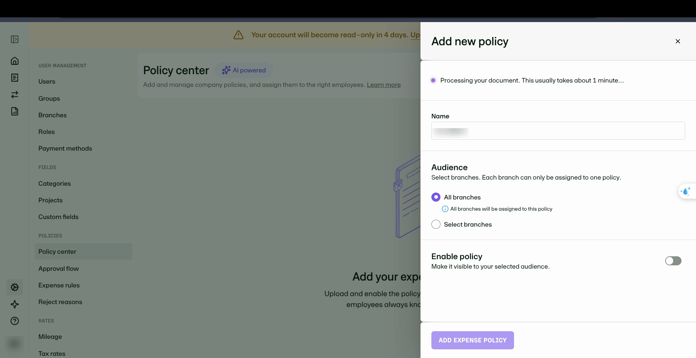
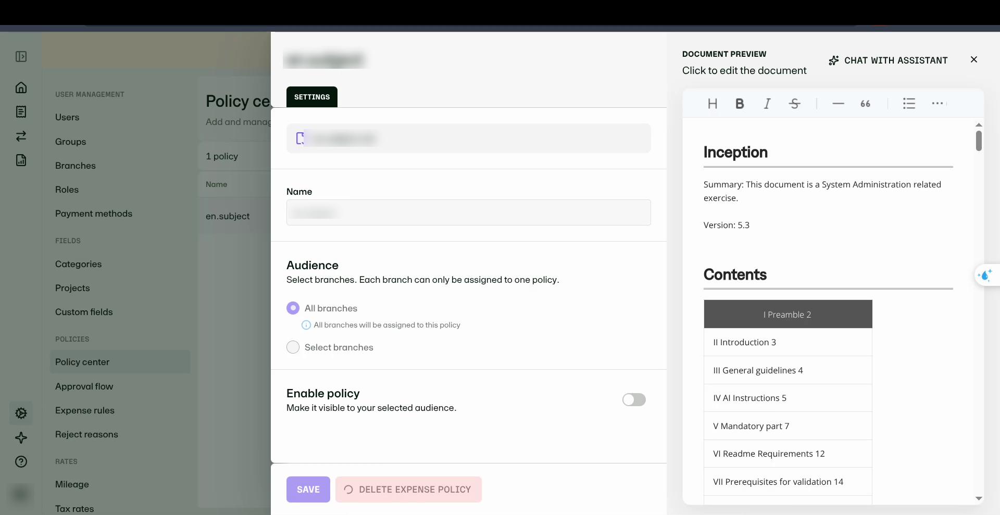
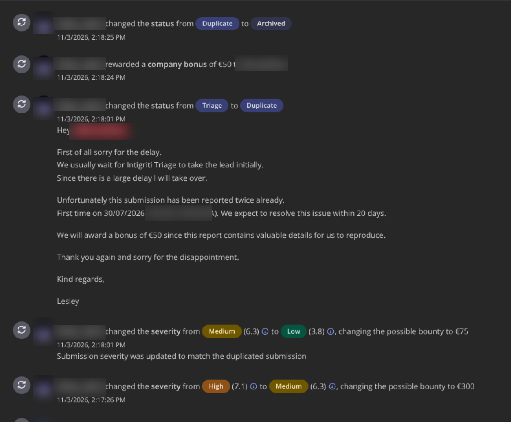

# The Policy Center behind a 404: a Personal User rewrote company policy, and the AI served it

*A missing server-side role check turned an administrator-only policy feature into an employee-accessible API—and made the policy assistant a downstream distribution channel.*

The expense-management platform made its authorization model look clear from the browser.

Administrators could open the company Policy Center, upload policy documents, assign them to branches, activate them, and ask an AI assistant questions about the active rules. Ordinary employees could not see the Policy Center in Settings. Direct navigation to its administrative route returned `404`.

The interface said no.

The API behind it said yes.

Using a second researcher-owned account with only the default `User` role, I was able to create, activate, read, modify, and delete company expense policies. When I activated policy text containing a unique marker, the administrator's normal policy assistant later returned that marker in a cited answer.

Everything described below was reproduced inside the vendor's sandbox with accounts and data I controlled.

## Two users, one company

I created two accounts in the same sandbox company:

- an administrator with access to company settings; and
- a Personal User with only the default employee-level `User` role.

On the administrator side, the Policy Center exposed the complete workflow: upload a policy, assign it to one or more branches, and enable it. A branch could be assigned to only one active policy, so activating a replacement displaced the previous policy for that branch.



The Personal User saw none of this. The Settings menu contained no policy-management entry, and opening the administrative Policy Center route directly ended at the application's `404` page.

At first glance, that looked like a properly restricted administrative feature.

## Replaying the administrative call

I captured the administrator's policy-creation request and replayed the same operation with the Personal User's bearer token:

```http
POST /v3/expense-policies HTTP/2
Authorization: Bearer <PERSONAL_USER_TOKEN>
Content-Type: application/json
```

```json
{
  "policyName": "Company Expense Policy 2026",
  "isActive": true,
  "branchIds": ["<BRANCH_ID>"],
  "markdown": "...",
  "originalFileName": "company-policy.md"
}
```

The server returned:

```http
HTTP/2 201 Created
```

The response also identified the Personal User as the actor:

```json
{
  "updatedBy": {
    "firstName": "Low",
    "lastName": "Priv",
    "email": "<PERSONAL_USER>"
  }
}
```

No role change or administrator approval took place. A token belonging to an ordinary invited employee was enough.

## One request replaced the active policy

The creation request contained `"isActive": true`. That made activation a side effect of creating the object rather than a separate privileged operation.

Because branch assignment was exclusive, the new policy displaced the administrator's previously active policy on the shared branch. The Personal User did not need to delete the original policy first; a single successful request changed which document the product treated as current.

This was the first important impact: an employee-level user could change the rules presented as company policy.

## Reading and rewriting existing policies

The authorization gap was not limited to object creation.

The Personal User could retrieve the full Markdown content of a policy revision:

```http
GET /v1/expense-policies/<POLICY_ID>/revisions/1/content/markdown HTTP/2
Authorization: Bearer <PERSONAL_USER_TOKEN>
```

```http
HTTP/2 200 OK
```

The same user could edit the object:

```http
PUT /v3/expense-policies/<POLICY_ID> HTTP/2
Authorization: Bearer <PERSONAL_USER_TOKEN>
```

```http
HTTP/2 200 OK
```

This included policies originally created by the administrator, not only objects owned by the Personal User.

## The AI assistant consumed the unauthorized change

The Policy Center included a **Chat with assistant** feature. It answered questions using the currently active company policy as grounding material.

To demonstrate the downstream effect without using harmful content, I placed a unique marker in the policy text and activated it with the Personal User account. The administrator then asked an ordinary question:

```http
POST /v1/expense-policies/chat/messages HTTP/2
Content-Type: application/json
Authorization: Bearer <ADMIN_TOKEN>
```

```json
{
  "message": "What is the daily allowance for Belgium?"
}
```

During the test, the assistant returned the value and marker inserted by the Personal User:

```text
The daily allowance for Belgium is 100 MAD. [...] PWNED
```



The assistant's behavior was downstream impact, not the root vulnerability. The underlying issue was still broken function-level authorization: the API allowed an employee-level account to control the source document that the assistant trusted.

The Personal User did not need access to the administrator's browser or session. They changed the active policy through their own authenticated API session; the administrator encountered the modified content through normal product use.

## Deleting an administrator's policy

The final operation I tested was deletion. Using the Personal User token, I deleted a policy created by the administrator:

```http
DELETE /v1/expense-policies/<ADMIN_POLICY_ID> HTTP/2
Authorization: Bearer <PERSONAL_USER_TOKEN>
```

```http
HTTP/2 204 No Content
```

The administrator's next request for the same object returned `404`. I found no recovery action for the deleted policy in the product interface.

The tested access matrix was therefore:

| Operation | Endpoint | Personal User result |
|---|---|---|
| Create and activate | `POST /v3/expense-policies` | `201 Created`; `isActive: true` |
| Read policy content | `GET /v1/expense-policies/{id}/revisions/1/content/markdown` | `200 OK`; full Markdown |
| Modify policy | `PUT /v3/expense-policies/{id}` | `200 OK` |
| Delete policy | `DELETE /v1/expense-policies/{id}` | `204 No Content` |

## Why the 404 did not protect the feature

The presentation layer understood that policy management was administrative. It removed the navigation entry and blocked direct access to the administrative page.

The service layer accepted the same user's token for every policy-management operation I tested.

In effect, the application checked whether the caller was authenticated and belonged to the company, but failed to enforce the role required for the function. Hiding the page prevented ordinary navigation; it did not prevent direct API access.

The issue maps cleanly to broken function-level authorization: an employee-level identity reached administrator-only operations by calling the underlying endpoints directly.

Several design details increased the impact:

1. **Creation and activation were combined.** One request replaced the policy assigned to a branch.
2. **The active policy fed another product feature.** The assistant treated unauthorized policy text as grounding material and returned it to an administrator.
3. **The same gap covered the full object lifecycle.** The Personal User could create, read, edit, activate, and delete policies.

## Remediation

The primary fix is server-side authorization on every policy-management operation.

Practical changes include:

1. Require an explicitly authorized administrative role for all `/v1/expense-policies*` and `/v3/expense-policies*` routes.
2. Apply that requirement through a shared, deny-by-default authorization policy rather than implementing independent checks endpoint by endpoint.
3. Add negative tests showing that a default `User` token receives `403 Forbidden` for create, read, edit, activation, and deletion operations.
4. Record policy activation, modification, and deletion in an administrator-visible audit log with the acting user and role.
5. Treat policy documents as untrusted grounding content for the assistant, preserving provenance and preventing document text from overriding higher-priority assistant instructions.

The AI hardening is defense in depth. It does not replace the missing authorization check.

## Disclosure outcome

I reported the issue through the vendor's Intigriti bug-bounty program. The submission was closed as a **duplicate** because the same function-level authorization gap had been reported twice before. The earliest referenced report was dated **30 July 2026**, and the vendor indicated that a fix was expected within 20 days of that report.

My submission's severity was changed from **High (7.1)** to **Low (3.8)** to match the duplicated report.

Although duplicate reports do not normally receive a bounty, the vendor awarded a **€50 company bonus**, explaining that the submission contained valuable reproduction details. The bonus recognized the quality of the evidence and write-up rather than treating the duplicate as a new finding.



The final outcome was:

- Resolution: **Duplicate**
- Final severity: **Low (3.8)**
- Standard bounty: **None**
- Company bonus: **€50**

## What I took away from it

This finding was a useful reminder that a hidden administrative page is evidence of intended access control, not enforcement of that control.

When reviewing role-based applications, I now treat UI restrictions as a route map:

- capture the privileged operation with an authorized account;
- replay it with the lowest available role;
- test the full object lifecycle, not only creation;
- follow the changed data into downstream consumers such as search, reporting, automation, and AI assistants; and
- distinguish the root authorization failure from secondary effects.

The 404 was not the end of the test. It was the reason to inspect what sat behind it.

## Resources

- [OWASP API Security Top 10: API5:2023 Broken Function Level Authorization](https://owasp.org/API-Security/editions/2023/en/0xa5-broken-function-level-authorization/)
- [OWASP Web Security Testing Guide: Testing for Privilege Escalation](https://owasp.org/www-project-web-security-testing-guide/latest/4-Web_Application_Security_Testing/05-Authorization_Testing/03-Testing_for_Privilege_Escalation)
- [CWE-862: Missing Authorization](https://cwe.mitre.org/data/definitions/862.html)
- [OWASP Top 10 for LLM Applications: Prompt Injection](https://genai.owasp.org/llmrisk/llm01-prompt-injection/)

---

*Target details redacted in accordance with the program's disclosure requirements.*
