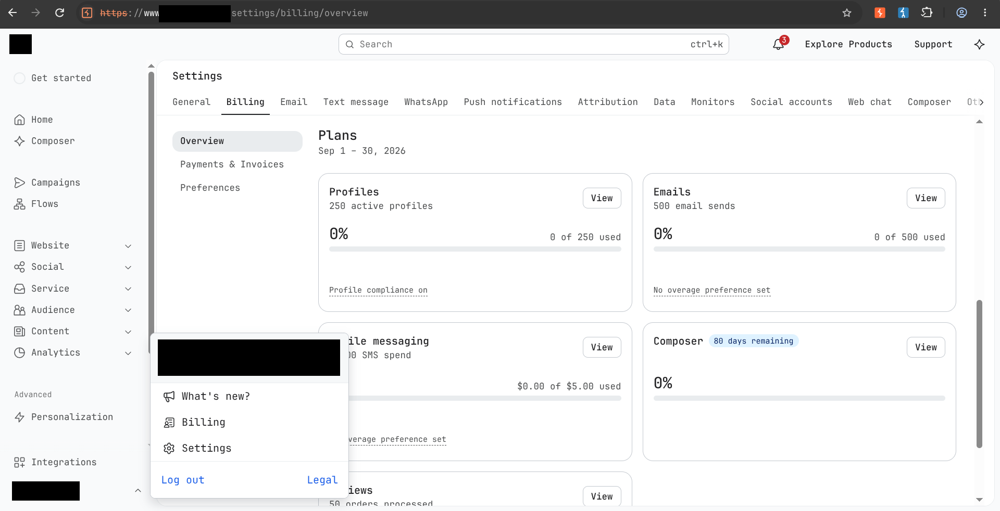
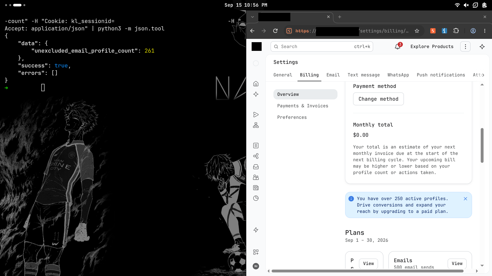
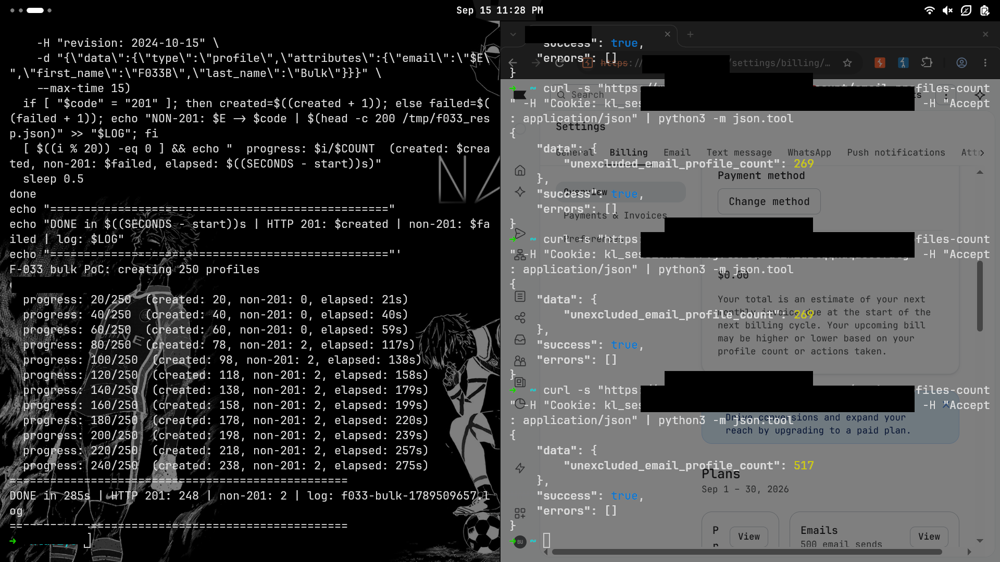
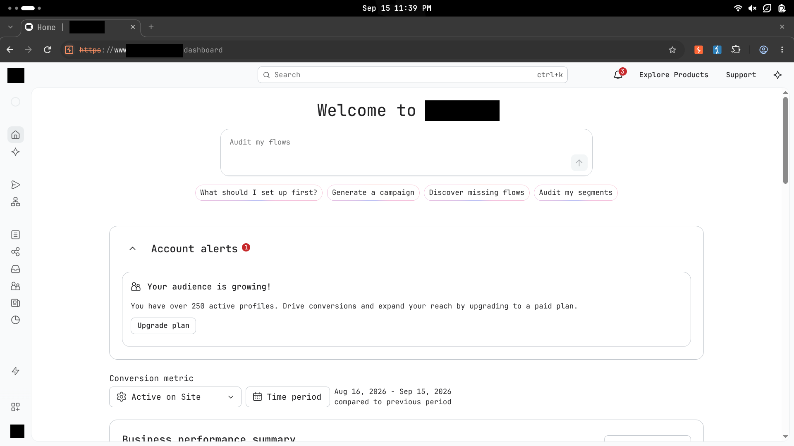
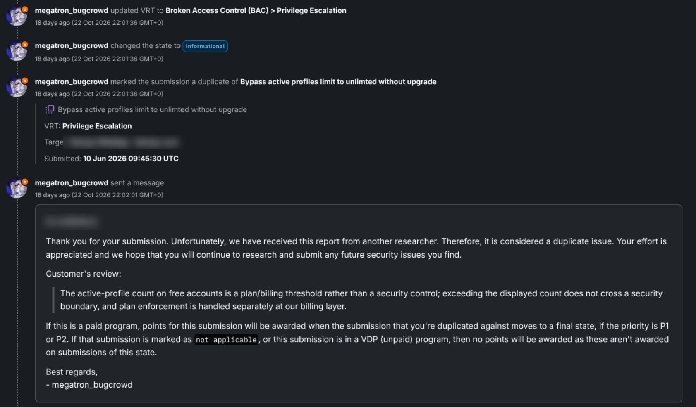

# The free plan that never says no: 517 profiles on a 250-profile limit

*A fresh-account experiment, a billing counter that lagged behind reality, and a bug-bounty report that ended as an Informational duplicate.*

The free plan advertised a simple limit: **250 active profiles**.

I wanted to know what happened when profile number 251 arrived. Would the API reject it? Would the account be suspended? Would the application ask for an upgrade before accepting more data?

On my test account, none of those things happened. The public profile API continued returning `201 Created`, the usage counter eventually climbed to **517 of 250**, and the account remained on the free plan.

That was only half of the story. The other half was why the first triage attempt failed to see it—and why the vendor ultimately classified the behavior as a billing matter rather than a security boundary.

## The number that did not make sense

My first test account was already showing a profile count near 840 despite being limited to 250 profiles. I had not encountered a hard stop, so I submitted the behavior to the vendor's bug-bounty program.

The first triage pass checked the billing overview and found no corresponding increase. The report was closed as Not Applicable with the reasoning that profiles had been created, but the billing page showed nothing new.

That response was understandable. The visible meter did not support the API results at the time the triager checked it.

The count appeared later.

In my testing, the billing overview behaved like a delayed snapshot rather than a live counter. It could continue displaying an older value after the API had already accepted new profiles. That meant a quick verification could see successful creation responses on one side and an unchanged billing page on the other.

To remove the uncertainty, I started again with a fresh account whose counter was known to be zero.

## Starting from zero

The new account was on the free plan. Its billing overview showed:

```text
Profiles: 0 of 250 used
Emails:   0 of 500 used
```



This clean baseline mattered. There were no old imports, deleted records, or previous experiments to explain the result.

## What happened at profile 251

The public intake endpoint was:

```http
POST https://api.<redacted>.com/api/profiles/
```

I used a standard API key with the documented `profiles:write` permission and sent 260 unique profile-creation requests, spaced roughly half a second apart.

The result was straightforward:

```text
Requests sent:       260
HTTP 201 responses:  260
Limit rejections:    0
```

Profile 251 was accepted. So were profiles 252 through 260. There was no upgrade requirement, quota error, or special response at the advertised boundary.

After the background counter caught up, the interface began showing the over-limit state:



The important evidence here was not only the number displayed by the billing page. The API log showed that the boundary itself had not been enforced: all 260 requests received the same successful response.

## Going past twice the allowance

I ran a second batch of 250 requests. Two connections reset before returning a response; the other 248 requests returned `201 Created`. Neither reset contained an application-level quota rejection.

The visible counter did not advance linearly with every response. It moved through intermediate values and later settled at **517 active profiles**.




I treated the API log and the billing counter as two separate pieces of evidence:

- The request log showed that creation continued after the 250-profile boundary.
- The vendor's own meter later confirmed that the account held 517 active profiles.

The account was now at **206% of its advertised allowance**, but it remained on the free plan. The dashboard displayed an upgrade prompt:

> Your audience is growing! You have over 250 active profiles. Drive conversions and expand your reach by upgrading to a paid plan.



It was a commercial nudge, not a technical block.

## A feature flag with an interesting name

While tracing the billing behavior, I found this treatment endpoint:

```http
GET https://www.<redacted>.com/ajax/billing/free-plan-profile-enforcement-bypass-treatment
```

My account received:

```json
{
  "is_in_free_plan_profile_enforcement_bypass_treatment": false
}
```

The name is suggestive: it references both enforcement and a bypass treatment. But the response is not enough to prove how the internal control works. `false` might mean the account was outside a bypass experiment, that enforcement was controlled elsewhere, or something entirely different.

For that reason, I treated the endpoint as context rather than proof. The reproducible observation did not depend on interpreting the flag: the API accepted profiles past the published limit, and the product later counted them.

## The contrast with the email limit

The same free plan also advertised a monthly email allowance. In separate testing, that limit behaved differently: delivery stopped when the send allowance was exhausted.

This did not prove that the profile limit was intended to use the same mechanism. It showed only that the two advertised limits were enforced differently: one stopped an operation, while the other produced an upgrade prompt.

That distinction became central to the final triage decision.

## One result I did not include in the finding

During the same session, several bulk-subscription jobs returned `202 Accepted` but never added the profiles to lists. That differed from behavior I had seen earlier.

I could not determine whether this was an over-limit side effect, asynchronous processing, or an unrelated backend issue. I therefore left it as an observation rather than presenting it as impact.

The confirmed behavior was narrower: the API created and retained profiles beyond the advertised free-plan count.

## Why the first verification missed it

The initial closure was based on a reasonable check, but the check happened before the visible usage meter caught up.

The intake API had already accepted the profiles, but the billing overview was still displaying an older snapshot. When the counter refreshed, the over-limit state appeared in the vendor's own interface.

This is a useful testing lesson for systems with asynchronous billing or usage meters: an unchanged dashboard does not necessarily mean the underlying operation failed. Capture the direct API responses, preserve timestamps, and return after the meter's reconciliation cycle.

## What Bugcrowd and the vendor decided

The initial Not Applicable closure did not sit right, so I resubmitted the finding with a clean-account reproduction: the `0 of 250` baseline, 260 successful creation responses, the later `517 of 250` counter, and the over-limit banner.

The resubmission was matched to an earlier report and closed as a **duplicate**. Its VRT classification was changed to:

```text
Broken Access Control (BAC) > Privilege Escalation
```

The final state was set to **Informational**. The earlier report was also Informational, so no award was issued under Bugcrowd's duplicate-handling rules.

The customer's position was:

> The active-profile count on free accounts is a plan/billing threshold rather than a security control; exceeding the displayed count does not cross a security boundary, and plan enforcement is handled separately at our billing layer.



That distinction matters. Bugcrowd associated the resubmission with an earlier report, while the customer did not consider the behavior a security-impacting privilege escalation. In their model, the profile count belongs to commercial plan enforcement, not authorization.

The final outcome was therefore:

- First submission: **Not Applicable** because the billing overview showed no increase
- Resubmission: **Duplicate** of an earlier Informational report
- Re-triaged VRT: **Broken Access Control > Privilege Escalation**
- Final resolution: **Duplicate**
- Final severity/state: **Informational**
- Award: **None**

## Was it still worth reporting?

I think so, with the final classification kept in perspective.

The test established a real product behavior: a free account could create more than twice the number of profiles displayed as its plan limit. It also exposed an easy verification trap caused by the delayed billing counter.

What it did **not** establish was access to another customer's data, an administrative privilege boundary, service disruption, or a quantified financial loss. The extra capacity remained inside my own account. Those limits support the customer's decision to treat the issue as Informational rather than as a security vulnerability.

The useful takeaway is not that every pricing-limit bypass is a high-severity bug. It is that plan limits can sit at the border between security, abuse prevention, and billing. A researcher needs to prove not only that the number can be exceeded, but also why exceeding it crosses a boundary the program considers security-relevant.

## How I would fix the behavior

If the 250-profile value is intended to be a hard entitlement, enforcement should happen in the intake path. Creation beyond the allowance should be rejected, queued, or require an upgrade. That check should use authoritative server-side state and remain safe under bulk or concurrent requests.

The billing overview can remain eventually consistent, but it should make the delay clear so customers and support staff do not mistake a stale number for current usage.

If the value is intentionally a soft commercial threshold, the product and pricing language should say so. Calling it an allowance or limit while continuing to accept profiles creates ambiguity for customers, testers, and triagers.

## Responsible-testing notes

All testing used my own accounts, API keys, and synthetic profile data. I did not access third-party records, send email during the profile-creation tests, or attempt to create service degradation. Credentials and account identifiers were removed from the published evidence.

## Resources

- Vendor API documentation for profile creation and bulk import
- [PortSwigger Web Security Academy: Business logic vulnerabilities](https://portswigger.net/web-security/logic-flaws)
- [OWASP Web Security Testing Guide](https://owasp.org/www-project-web-security-testing-guide/)

